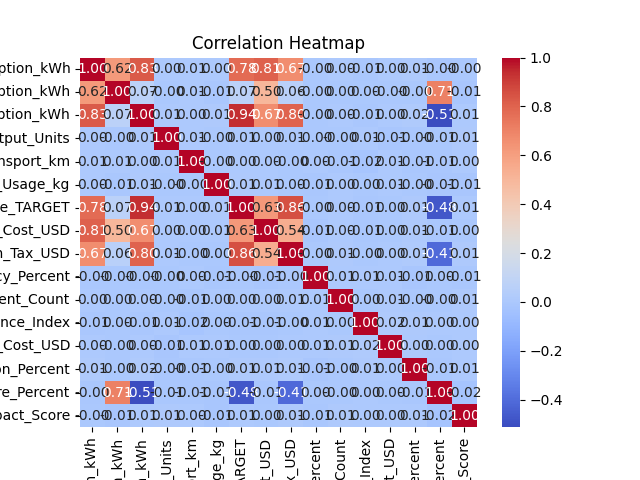
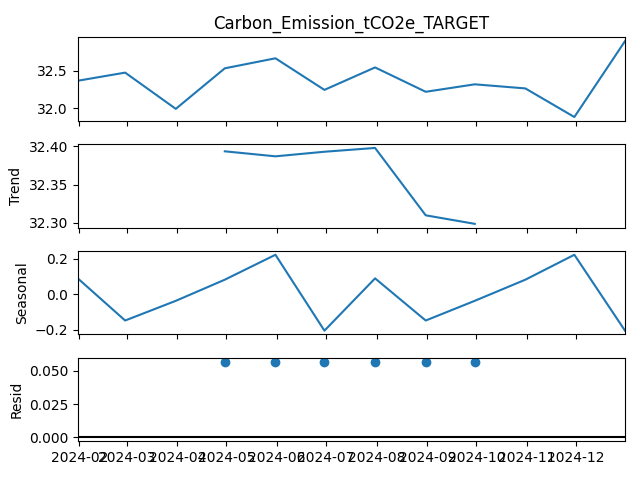

# Carbon Emissions Analysis

Exploratory and statistical analysis of an industrial carbon-emissions dataset with Python —
cleaning, distributions, correlations, sector comparisons and time-series decomposition.

*University course project (Python programming).*

<p align="center">
  
  
</p>

## Dataset

[`carbon_emission_dataset_with_Industry.csv`](carbon_emission_dataset_with_Industry.csv) — about
18 000 company-day records across industry sectors, with energy use (renewable / non-renewable),
production output, supply-chain transport, raw materials, energy cost, carbon tax, process
efficiency, reduction strategies and the target variable **`Carbon_Emission_tCO2e_TARGET`**.

## What the script does

| Section | Analysis |
|---|---|
| 1. Load & inspect | `head`, `info`, `describe` |
| 2. Cleaning | Mean imputation of missing numeric values, date parsing |
| 3. Exploratory | Summary statistics and distribution plots (histogram + KDE) for key variables |
| 4. Bivariate / multivariate | Scatter plots, correlation heatmap, emissions by industry sector (box plots), pair plot |
| 5. Time series | Emissions over time, monthly averages, additive seasonal decomposition (`statsmodels`) |
| 6. Advanced questions | Variability ranking, normality test (`scipy.stats.normaltest`), correlation ranking, linear trend (`np.polyfit`), monthly seasonality |

All 21 generated figures are in [`output/`](output/), and the written answers to the research
questions are in [`section_6_answers.txt`](section_6_answers.txt).

## Key findings

- **Total and non-renewable energy consumption** are the variables most strongly correlated with
  emissions.
- Emissions are **not normally distributed** (normality test p < 0.05).
- There is a **slight upward trend** in monthly average emissions and a visible **seasonal
  pattern**, with higher emissions in mid-year months.

## Run it

```bash
pip install -r requirements.txt
python script.py
```

Each figure opens in a window (`plt.show()`); close it to continue to the next one.

## Key technical challenges

- Cleaning a wide, mixed-type dataset without throwing away rows.
- Turning noisy daily records into a monthly series suitable for seasonal decomposition.
- Picking the right statistical test for each question and interpreting the results honestly.

## What I learned

<!-- TODO: write this section yourself -->
